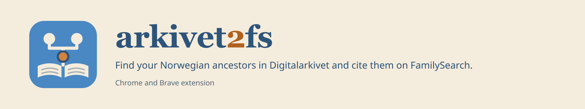

# arkivet2fs



A Chrome/Brave/Firefox extension that connects FamilySearch (FS) with Norway's Digitalarkivet
(DA). It finds a FamilySearch person's records in Digitalarkivet. It also turns a
Digitalarkivet record into a FamilySearch source, with an Evidence Explained–style
citation, and attaches it to the tree persons the record names.

```
FS person page ──(1: "Digital Arkivet" in Search Records)──▶ search page
     ▲                                                          │ 2: searches DA,
     │                                                          │ ranks the hits
     │                                                          ▼
FS source, attached ◀── linker (3: you review) ◀── "Review & Attach" on a hit,
  to the tree persons                                or the toolbar icon on a DA record
```

## Install

There's no build step: the extension is its source files.

1. Download `arkivet2fs-X.Y.Z-chromium.zip` from the latest release:
   https://github.com/Dude4Linux/arkivet2fs/releases/latest (or clone the repository,
   or **Code** → **Download ZIP**, for the newest code).
2. Unzip it where it can stay, for instance in your home folder. It unpacks to a folder
   named `arkivet2fs`.
3. Open `chrome://extensions` (or `brave://extensions`) and turn on **Developer mode**.
4. Click **Load unpacked** and choose the `arkivet2fs` folder.
5. Pin the extension's icon to the toolbar.

You need to be signed in to FamilySearch. Digitalarkivet needs no account.

**In Firefox** (140 or later) and LibreWolf, until the extension is on Mozilla's add-ons
site: unzip the package as above, open `about:debugging`, choose **This Firefox**, then
**Load Temporary Add-on…** and pick `manifest.json` in the `arkivet2fs` folder. Firefox
keeps it until it closes; load it again after a restart (your stored persons and drafts
are kept). If Firefox hasn't given the extension Digitalarkivet and FamilySearch, its
pages show **Allow access**: click it once. In LibreWolf, keep FamilySearch's cookies
when it closes (Settings → Privacy & Security → Cookies and Site Data → Manage
Exceptions → `https://www.familysearch.org`, Allow), or you'll be signed out each time.

**To update**, unzip the new release over the same folder, replacing its files, and
click the reload button on the extension's card in `chrome://extensions`. Chrome keeps
an unpacked extension's stored persons and drafts by its folder, so keep the folder
where it is.

From 1.2.0 the extension tells you when a new release is out: an arrow on its toolbar
icon, a notification, and "v. X.Y.Z is out" at the top of its pages. Click the version
there (or the icon with the arrow, on a page other than Digitalarkivet) for the
**Updates** page: what's new, and a **Download** button that saves the package only
after checking it (its size and SHA-256 as the release gives them, and the signature
against the maintainer's key below; a file that fails is not saved). Unzip it over the
folder, then click **Reload the extension** there. **Remind me later** waits three days;
**Skip this version** waits for the next one. From 1.6.0 the check is off until you
click **Allow the check** on the Updates page, which asks the browser for GitHub's two
hosts. It then runs once a day and sends one request to GitHub (`api.github.com`),
which sees your IP address and nothing else; turn it off on the Updates page. A copy installed from a store isn't checked: the store
updates it.

**To check a download** (optional): each package is signed with the maintainer's key,
`keys/release.pub` in the repository, whose SHA-256 fingerprint is

    7642e107e134dfb53e43e4932b32a23301b88b8d28a32b10abe367d16d36bc54

You need OpenSSL 3 (`openssl version`), and curl or GitHub's `gh`. In a clone of the
repository, one command downloads a release into a temporary folder, checks it and
removes the folder again:

    cd arkivet2fs        # your clone
    sh tools/release vX.Y.Z --keep ~/Downloads/arkivet2fs-X.Y.Z

Without a version it checks the clone's own (in `manifest.json`). `--keep` (optional)
copies the checked package to that folder, ready to unzip. The script prints the key's
fingerprint, which must be the one above, then lines starting with `OK:` and `All good`.
With `gh` signed in it also checks GitHub's record of where the package was built (its
attestation). A line starting with `BAD:` means the file isn't the one that was signed:
don't install it. (For the maintainer, the same script also signs, tests and publishes a
draft release.)

To check a package you downloaded yourself, put it in one folder with its `.sig`,
`SHA256SUMS` and `SHA256SUMS.sig` (all from the release's **Assets**) and run
`sh ~/path/to/the/clone/tools/verify.sh arkivet2fs-X.Y.Z-chromium.zip` there. Both
scripts take the key from their clone (`keys/release.pub`); a copy elsewhere needs the
key's path (`verify.sh`: after the package; `release`: `--key`).

## Use

### 1. Start from a FamilySearch person

Open a person's details page in the FamilySearch tree. In the **Search Records**
panel, below Google, there's a **Digital Arkivet** entry. Clicking it opens the search
page in a new tab. The page is filled in with the person's names, events, places and
family.

### 2. The search page

The sidebar on the right holds the search criteria, laid out like FamilySearch's
record search. You can edit any of them and click **Search**:

- **Names:** given names and surname, one row per name; FS alternate names are added,
  without nicknames such as "Big" or "Little" (two brothers Lars).
  The names follow the patronymic convention. In "Tollef Johansen Rysstad",
  Johansen is the surname. Rysstad is a farm only when a farm of that name lies
  near the person's places. Otherwise it's a family or place name and is searched as
  the surname.
- **Events:** birth or christening, marriage, residences, emigration or immigration,
  death or burial; years are ±2. A full birth date (a gravestone's "16 July 1846",
  from Find a Grave, say) is searched ±1 and kept in the **Date** field, for
  scoring. With an emigration or immigration year, the searches
  stop two years after it (the latest, when FS has several), and the ones that can
  only find later records, such as a marriage in America, are skipped. The first
  event FS has outside Norway (a residence, marriage or death in America) counts the
  same way, under **First place abroad**: the searches stop two years after it, or
  after the emigration if that's earlier. Clear its year to search later years too.
- **Farms:** each farm gets its own "Records at <farm>" search.
- **Relatives:** father, mother, spouses and children. Untick a relative to leave them
  out of the searches.
- **Where to search:** add DA counties or municipalities. The municipalities of the
  person's FS places are suggested.
- **Record kinds:** turn a kind of search on or off.

The extension doesn't run one broad search. It runs one search for each life event:

- own baptism (by parent, and by birthplace)
- confirmation
- marriage (one per spouse)
- the children's baptisms
- censuses
- emigration
- moving away
- burial
- all records under the name

Some searches find no hits. Those are tried again with other spellings, such as
the father's patronymic or the FS alternate names. Searches that find more than 100
hits are narrowed to the person's municipalities. Each search is listed with its hit
count and an **Open on DA** link to the same search on Digitalarkivet.

The hits are merged, so each record appears once. They're grouped (Baptism,
Confirmation, Marriage, Children's baptisms, Census, Emigration, Moving, Burial,
Other) and ranked by a score. Each hit shows the reasons for its score:

- ✓ matches the FS person: a name, a year, a place, a farm, a relative
- ≈ close: another spelling, or one of DA's name variants
- ✗ contradicts FS: wrong sex, a year far off, too young for the role

A birth year scores by how far it is from FS's: the same year +2, one year off +1, two
or three years off -2, up to nine -4, and ten or more -6 (another generation). With
FS's full birth date, a baptism before the birth is another child, and a baptism
within half a year after it counts as the same year.

After the searches, the extension opens the records of the best hits. It checks the
people in them against the FS relatives: the parents of a baptized child, the couple of a
marriage, a census household, an emigrant's destination. A relative with a close given
name (Astri for Astrid) is ≈ +2; another given name (Anne for Astrid) is -3. A
baptism's date of birth is checked against FS's full birth date: the same day +3,
another day -2. That separates namesakes:
several men of the same name in one census, for example. Hits scoring below 0 are
dimmed.

A record you've attached in the linker says so on its hit, in this search and every
later one (when you search the spouse, say): "✓ Attached 10 November 2026 to Lars
Halvorsen, Halvor Larsen", linked to who has the source on FamilySearch, and
**Review again** instead of **Review & Attach**. A hit the person searched for has is
tinted. The search page you came from shows it as soon as the linker is done. A run
where a step failed says "⚠ Not all done". The extension keeps this for the last 300
records, in the browser only.

### 3. From a DA record to a FamilySearch source

Click **Review & Attach** on a hit, or open a DA record and click the extension's
toolbar icon. The linker page opens with the source, ready to review. Nothing is saved
on FamilySearch until you click **Create source and attach** (**Update source and
attach** when the source is already in your SourceBox).

The source's fields can be edited:

- **Title:** "<year>, <principal> - <source title> - <record type>", for example "1865,
  Halvor Larsen household, Bakken nedre, Nordlien - Vågå - Census" (a census names the
  residence and census district when DA gives them; the notes have both lines too)
- **Date** and **Web page** (the record's permanent link)
- **Citation:** place (general to specific), source, page or entry, date, permanent ID,
  link and scanned image
- **Notes:** the person's own fields and everyone in the record with their roles,
  with codes and Norwegian roles in English

It doesn't matter whose page in the record is open. If you open the father's page on a
baptism, the source still describes the child.

Below the source, each person in the record has a row:

- **Name.** You can edit it, and the new name goes into the title, citation and
  notes. A child baptized by given name only ("Ole, son of Lars Halvorsen") gets
  suggestions: the father's patronymic (Ole Olsen), or the name of the tree person
  you pair the child with. Click one to use it.
- **Tree person.** Choose who in the tree the record is about: the FS person, or
  their father, mother, spouses or children, or another person by FS ID. The linker
  suggests pairs: the FS person for the hit, and relatives whose given names match,
  with children also matched by birth year. A relative with another name in the
  record is mentioned, not chosen, so a second wife or a namesake isn't attached by
  mistake.
- **The record beside the tree.** Under the name and the tree person, a table puts
  what the record says of the person (name, sex, birth, the record's event, residence,
  occupation) beside what FamilySearch has of the tree person, fact by fact, as FS's
  Source Linker does: ✓ where they agree, ≈ where they're close (Astri for Astrid, a
  birth year a year or two off), and ✗, highlighted, where they differ. Ages count as
  years about, so 17 in the 1865 census fits a birth in 1848 or 1849. FamilySearch's
  side starts with the family card's years and fills in from the tree person's own
  page, read in the background once the page is shown (it only reads).
- **Adding the record's facts to the tree.** Under the table, **Add to FamilySearch**
  lists what the record could add to the tree person: a christening, death, burial,
  residence or occupation the tree lacks, an emigration (as a custom event titled
  Emigration, since FamilySearch has no emigration fact), a name the tree doesn't have
  (as an alternate name, Also Known As unless you choose another type), and a birth,
  christening, death or burial that differs. FamilySearch keeps one of each of those,
  so the suggestion combines the two: the more precise part of each, such as the
  record's "16 July 1846" over FamilySearch's "1846" and FamilySearch's "Vågå, Oppland,
  Norway" over the record's "Vågå", with FamilySearch's value shown beside it.
  Everything is unticked. Tick what you want and edit the boxes; the reason ("From
  <source title>, Digitalarkivet, Permanent ID <id>.") can be edited too. Ticking a
  birth, christening, death, burial or residence also ticks its tag. The ticked
  changes are listed above the buttons. **Check with FamilySearch** fills each one in
  FamilySearch's own form in the background window, takes FamilySearch's standard date
  and place for the record's year, and cancels (nothing is saved); the boxes then show
  FamilySearch's forms for you to look over. A residence's place starts with the farm
  ("Bakken nedre, Vågå, Oppland, Norway"); when FamilySearch doesn't know the farm in
  that municipality, the place stays as written rather than lose the farm. A couple's
  marriage can't be added yet.
- **New person on FamilySearch.** For someone in the record who isn't in the tree
  yet, choose **New person on FamilySearch…** in the tree person list. A form opens
  at the side, filled in from the record: the given names and the patronymic as the
  surname (a farm name after it is left out, since it's an address; add it back if it's
  a family name), sex, birth and death, with places written as FamilySearch names them
  ("Vaage" becomes "Vågå, Oppland, Norway"), and the relationship to someone paired
  here as the record tells it (a baptized child of the paired father and mother, a
  wife of the paired husband, ...). For a child you choose the father and the mother
  from everyone paired on the page, or only one; the record's other suggestions are
  buttons. Check and change what you like, then **Find on
  FamilySearch**: FamilySearch's own Add Child, Add Spouse or Add Parent form is filled
  in on the tree person's page in a tab, with FamilySearch's standard dates and places,
  and FamilySearch looks for people who may be the same. They're listed at the side.
  **Use this person** links one of them on FamilySearch as that relative (with
  FamilySearch's Add Match, unless the family already has them so: a person made
  before whose links were removed is put back in the family) and pairs the row with
  them; **Create person** creates the person on FamilySearch as that relative,
  pairs the row with them and closes the tab. Nothing is saved before you click one of
  them; **Cancel** closes the form and FamilySearch's dialog. A christening or burial,
  which FamilySearch's form doesn't take, is listed in the form for you to add on the
  new person's page; the source's tags can add them too.
- **Tags** (Name, Sex, Birth, Christening, Death, Burial, Residence) and the
  **reason** for attaching. Both are filled in by role; for example, a baptized child
  gets Name, Sex, Birth and Christening.

In a census, everyone at the residence gets a row, by household: the old parents,
a married son's family, a brother's family lodging there. The linker pairs them
through the tree, starting from the FS person: their relatives first, wherever they
live at the residence, then each paired relative's own family. To do that it opens
those relatives' FamilySearch pages in a background tab, reads their families (it
only reads), and closes the tab; a line above the rows says how many it paired. For
example, from Halvor Larsen in 1865, it pairs his wife and children, his parents in
household 02, and through his father, his brother Iver's family in household 03.

The census's own family positions count too: "hans Kone", "deres Søn", or "hans
Fader" heading the next household. A resident the census places in another relation
than the tree isn't paired. Households the census doesn't link to the record's own,
and with nobody in the tree, are hidden, such as the lodgers' and servants' families
on an 1801 farm. A link under the rows shows them. If you opened a namesake in another
household, the linker switches to the household where the FS person fits, and says
so above the rows.

Many parishes kept two church books, the priest's ministerialbok and the clerk's
klokkerbok, and Digitalarkivet transcribed both, so one baptism can turn up twice,
each copy with its own permanent ID and sometimes with a name spelled differently.
The search page shows the two as one hit, with "Also in the other church book" and a
link to the second entry. **Review & Attach** then opens both together: the linker
shows the two entries side by side with the differences marked, and fills in a source
for each book, the book named in its title and citation. Each source's notes name the
other book's entry and list where the two differ, so nothing either transcription
says is lost. You pair the people once, and both sources are attached to them; the
tags go on the ministerialbok's source only. An entry found in one book only is a
single source as before.

When the linker opens, it first looks in your SourceBox on FamilySearch, as FS's own
Source Linker flags a record you've attached before; until it's done, the page says
what it's doing, and the source and the people appear when it knows. It reads
FamilySearch in a window of its own placed right behind the linker's, out of the way of
your tabs (Chrome doesn't draw a minimized window, and FamilySearch's SourceBox doesn't
load in one), searches every folder for the source's title, reads who
the source is attached to, and closes the window again (it only reads). In Firefox, and
in Chrome on some desktops, that window comes up in front of the linker while it reads,
and you see FamilySearch's pages go by: leave it, it closes by itself. The linker reads
the relatives' families and the paired persons' details in it the same way. A source already in your SourceBox is shown in green, with
an **Attached To** link to its page on FamilySearch (point at it to see how many of the
people paired here have it); with two church books, each source is marked on its own.
A person who has the source is highlighted in green too, as in FS's Source Linker (with
two church books, a green edge only for one who has just one of them), and their row
says so. If you change the title, or the check failed, **Check the SourceBox again**.

The check also reads the source's fields in the SourceBox (FamilySearch's Edit Source
form, cancelled). Where they differ from the ones here, both filled in, they're listed
under the source with FamilySearch's text and a choice: use the record's (the default),
or keep FamilySearch's. For the notes, the default keeps FamilySearch's and adds the
record's lines they lack below, unless FamilySearch's notes are an older copy made by
the extension; then the record's replace them. If a source of the same title in the
SourceBox is of another record, the linker says so: give this source another title.

The family comes from the FS person you started the search from. From the toolbar
icon, the linker uses the last person you searched for when their name is in the
record. Otherwise, type the FS ID at the top.

**Create source and attach** opens a FamilySearch tab and works in it step by step.
The page lists each step as it goes:

1. It creates the source in your SourceBox. If a source with the same title is
   already there, in any folder, it uses that one instead and updates it: the title,
   date, web page, citation and notes as you reviewed them here replace FamilySearch's
   (a field left empty here keeps FamilySearch's, as does one you chose to keep), with "Updated from the record on
   Digitalarkivet." as the reason for the change. The button then reads **Update source
   and attach** (**Create or update sources and attach** with two church books, one
   source there and one not).
2. It attaches the source to each chosen person by ID, with your reason. Someone who
   already has the source is left as they are, so a source attached to some of the
   people before is attached only to the rest.
3. It adds the ticked tags. Tags already there are kept. A residence is tagged only
   when the person has exactly one. A fact the linker adds is tagged in step 4, once
   it's there.
4. It makes the ticked changes to the tree persons, on each one's page, with your
   reason, and tags the source to each fact it added or changed. Only people who now
   have the source get them.

When every step has gone through, the FamilySearch tab is closed and you're back on the
linker, with the steps listed. If a step failed, the tab stays open where it stopped.

**Create source only** (**Update source only**) puts the source in your SourceBox, or
updates it there, without attaching it.

Supported records: baptisms, confirmations, marriages, burials, censuses, emigrant
protocols, moving lists (out- and in-migration) and probate.

## Language

The search page, the linker and the notifications are in English, Norwegian Bokmål
or Nynorsk, as DA is. The first time, the extension uses your browser's language
(Nynorsk for nn, Bokmål for nb or no, otherwise English). To change it, use the menu
at the top of the search page or the linker. Both pages, and the notifications, then
use that language.

- **The source stays in English.** The title, citation and notes that go to
  FamilySearch are in English, for every language, because the FS tree is shared
  worldwide. The reason for attaching follows your language.
- **DA pages in any language work.** The toolbar icon also works on Bokmål and
  Nynorsk record pages. The extension reads DA's English version of the same page.
  Links to DA open in your language.
- **FS in Norwegian works too.** The "Digital Arkivet" entry also reads FS person
  pages shown in Norwegian.

## Good to know

- **Digitalarkivet limits requests.** The searches are spaced a second apart and
  cached for the session. If DA refuses requests, or is down (a page and its front page
  both fail), the page says so and stops, and the extension sends DA nothing more for a
  while: 15 minutes after a refusal, 5 after an outage. The warning says until when;
  **Try again now** asks DA again at once.
- **Transcriptions vary.** Names are spelled many ways (Jon, Joen, John; Siri, Sirj,
  Siry), and parents are sometimes transcribed wrongly. So a ✗ on one relative lowers
  a score only a little. Always check the record, and the scanned image when there is
  one, before you attach it.
- **Data stays between the sites.** The extension sends requests only to
  digitalarkivet.no and familysearch.org. To check farm names, it also queries Rygh's
  *Norske Gaardnavne* (dokpro.uio.no) and Kartverket's place names (ws.geonorge.no).
  The update check, once you've allowed it on the Updates page, asks GitHub
  (api.github.com) for the latest release once a day, and a download comes from
  GitHub's file host; neither gets anything about you or your records.
  Search results are kept only for the browser session. The extension also keeps the
  last 30 FS persons you searched for (name, events and family), so the linker can
  pair a record with them. They stay in the browser's extension storage.

## Files

| File | Purpose |
|------|---------|
| `manifest.json` | Extension configuration (Manifest V3) |
| `_locales/` | The extension's name and description in English and Norwegian |
| `i18n.js`, `i18n_strings.js` | The languages: choosing one, and the Bokmål and Nynorsk texts |
| `fs_person.js` | The "Digital Arkivet" entry on FS person pages |
| `background.js` | Toolbar icon, opening the search page and the linker, keeping the FS persons, the daily update check |
| `access.js` | Asks for the sites the extension needs when the browser hasn't given them |
| `releases.js` | The update check: GitHub's latest release, checking a download against the release key |
| `update.html`, `update.js`, `update.css` | The Updates page: the new release's notes, a checked download, how to install it |
| `farms.js` | Farm or family name? (Rygh, Kartverket) |
| `search.html`, `search.js`, `search.css` | The search page |
| `da_places.js` | DA's counties and municipalities, old place names |
| `da_search.js` | The DA searches |
| `da_match.js` | Merging, scoring and grouping the hits |
| `da_record.js` | Reading a DA record: citation, title, notes, people |
| `da_verify.js` | Checking hits' records against the FS relatives |
| `linker.html`, `linker.js`, `linker.css` | The linker: reviewing the source and pairing the record's people with tree persons |
| `fs_attach.js` | The linker's steps on FamilySearch: find the source and who has it, create it, attach it, add tags |
| `icons/` | The extension's icons (`icon*.svg` are the sources of the PNGs) and the README banner (`banner.html` → `banner.png`) |
| `citation.md` | The citation format |
| `plan.md` | Design notes and milestones for the FS → DA search |
| `release-plan.md` | The plan for packages, signed releases and other browsers |
| `tests/` | The tests (`npm test`), on sanitized Digitalarkivet pages; see `tests/README.md` |
| `.github/workflows/ci.yml` | Runs the tests and a build on GitHub for every push and pull request |
| `.github/workflows/release.yml` | Drafts a release, with the package, for each version tag |
| `tools/` | Building the package (`build.mjs`), signing a release (`sign.mjs`), checking a download (`verify.sh`); `release` signs, tests and publishes a draft release, or checks a published one |
| `keys/release.pub` | The public key the releases are signed with |
| `CHANGELOG.md` | What changed in each version |
| `SECURITY.md` | How to report a security problem, and what the extension does with your data |
| `LICENSE` | The GNU General Public License, version 3 |

The version is shown when you hover over the extension's toolbar icon, at the top
right of its pages, and on its card in `chrome://extensions`. It counts up as MAJOR.MINOR.PATCH: fixes raise the
last number, new features the middle one.

Developer notes are in `CLAUDE.md`. After changing the code, reload the extension on
`chrome://extensions`.

## Problems and contributing

Report bugs and ideas in the [issues](https://github.com/Dude4Linux/arkivet2fs/issues):
the DA record or search (its address or permanent ID), what you expected, and what
the extension did. **Copy report**, at the top of the search page and the linker,
puts all of that on the clipboard, with the version and browser and a place to say
what went wrong; it also names the tree persons you paired, with their IDs. Issues
are public: read the report before you paste it, and take out living people. Please
don't paste FamilySearch pages. Security problems go privately, as `SECURITY.md` says.

Pull requests are welcome. Before you open one:

- **Run the tests:** `npm install` once, then `npm test` (Node 22.13 or later; about
  2 seconds, offline). GitHub runs them again on the pull request.
- **Add a test** for each bug you fix, in the `tests/` file of the extension file you
  changed. Write the expectation from how it should behave, not from what the code
  gives.
- **Real cases, made-up names.** A new Digitalarkivet page for the tests is saved with
  `tests/capture.js` and sanitized with `tests/sanitize.js` (historical records only).
  The sanitized page in `tests/fixtures/da/` has made-up names, IDs and links, and only
  that goes in the pull request; `tests/private/`, with the real page, stays with you.
  Or just give the record's address in the pull request, and the page is added for
  you. Never add FamilySearch pages: they hold living people and other users' work.
  `tests/README.md` says how.
- **Keep the extension dependency-free.** It has no build step (the release package
  is the source files, zipped by `tools/build.mjs`); `package.json` is for the tests
  only. A new file of the extension needs a line in `tools/build.mjs`'s lists, or the
  build stops.
- **Say what changed for users** in a line under a new version's heading in
  `CHANGELOG.md`; the version number is the maintainer's to set.

## License

Copyright © 2025–2026 Dude4Linux

arkivet2fs is free software: you can redistribute it and/or modify it under the terms
of the GNU General Public License as published by the Free Software Foundation, either
version 3 of the License, or (at your option) any later version.

It is distributed in the hope that it will be useful, but WITHOUT ANY WARRANTY;
without even the implied warranty of MERCHANTABILITY or FITNESS FOR A PARTICULAR
PURPOSE. See the GNU General Public License in [`LICENSE`](LICENSE) for details.

In short: you may use, study, share and change it, also commercially, but a changed
version you distribute must be under the GPL too, with its source and this notice.
